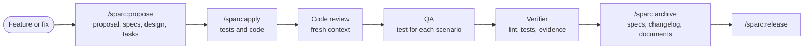

# <picture><source media="(prefers-color-scheme: dark)" srcset="docs/assets/logo-dark.svg"></picture>

sparc is a harness for spec-driven work with agents in Claude Code. The name comes from "spec", "arc" (architecture) and the spark of an idea.

Website: [sparc.apps.vensas.de](https://sparc.apps.vensas.de) (source in [`website/`](website/)).

## Overview

Agents write code fast, but the specs, the architecture and the documents fall behind. sparc keeps them together. You tell a feature, and sparc gives you a reviewed and tested change, with specs, decisions and documents that agree with the code.

sparc adds a small team of roles, a fixed document set and two checks on top of [OpenSpec](https://openspec.dev). For the goal and the plan, see the [backlog](docs/backlog.md).

## Key Features

- **From idea to tested change.** Each feature goes through propose, apply and archive. Running apply approves the change, so you do not type an approval.
- **A team of roles.** Five roles do their part of each change: product owner, architect, UX designer, software engineer and QA engineer.
- **Independent review and proof.** A reviewer in a fresh context reviews each change. The QA engineer proves each spec scenario with an automated test.
- **Documents that stay correct.** README, backlog, changelog, C4 diagrams, architecture canvas and ADRs have one home for each fact. Two checks without an LLM find drift and stop an incomplete change.
- **Known formats.** OpenSpec, C4, MADR, the Architecture Communication Canvas, Keep a Changelog, Semantic Versioning and Conventional Commits.

## How It Works

### The loop of a change



The product owner writes the proposal and the specs. The architect writes the design, the ADRs and the tasks. The software engineer implements the tasks test first and reviews the change. The QA engineer proves the specs, and the product owner accepts the change from the QA report.

### The files of a project

`/sparc:init` makes these files. Each fact has one home, and the other files link to it.

```text
your-project/
├── README.md                  introduction, features, get started
├── AGENTS.md                  commands, structure and rules for agents
├── CHANGELOG.md               done work, for each release
├── openspec/
│   ├── config.yaml            sparc rules for each OpenSpec step
│   ├── specs/                 required behavior
│   └── changes/               open and archived changes
└── docs/
    ├── backlog.md             goal and open items
    ├── architecture/
    │   ├── c4.md              system context and containers (Mermaid)
    │   └── canvas.md          architecture canvas, risks and open points
    └── adr/
        └── 0000-template.md   template for decisions (MADR)
```

### Terms

| Term | Meaning |
|---|---|
| change | One feature or fix as an OpenSpec change in `openspec/changes/<id>/`: proposal, spec deltas, design, tasks and QA report. |
| role | A rule file in [`rules/roles/`](rules/roles/) that a skill follows. A role is not an agent type. |
| check | [`scripts/check.mjs`](scripts/check.mjs). It finds document drift without an LLM. A hook runs it when the agent stops. It warns and does not block. |
| document drift | A document that does not agree with the code, the specs or the changes. An example is a backlog item of an archived change. |
| verifier | [`scripts/verify.mjs`](scripts/verify.mjs). When all tasks of a change are done, it runs the `Lint`, `Test` and `Verify` commands of the project and checks the QA evidence. If a check fails, the agent cannot stop. After 3 blocks in a row, the failures become open points. |
| decided ADR | An ADR with a status other than `proposed`. Its text does not change. The check uses git history to find each change to it. |
| current ADR | An ADR that agents follow: `accepted` or `amended`, or `proposed` in its own change. See [`rules/adr.md`](rules/adr.md). |
| superseded ADR | An ADR that a newer ADR replaces. This is normal: a decision changes, and its history stays. The canvas section "Core Decisions" shows the status of each ADR. |
| sparc markers | The comments `sparc:begin` and `sparc:end` in project files. `/sparc:update` replaces only the text between them. |
| open point | Missing information or a risk. Agents write it in the canvas and do not guess. |

All English text in sparc follows ASD-STE100 Simplified Technical English on purpose. Short sentences and one word for one meaning give agents and readers one clear meaning.

### Limits and cost

- Each behavior change goes through propose, apply and archive, also a small fix.
- The fresh-context code review starts one more agent for each change. This costs tokens and time.
- sparc needs Claude Code, OpenSpec, Node.js and git.

The canvas lists the measured cost and the open risks: [Core Risks and Missing Information](docs/architecture/canvas.md#core-risks-and-missing-information-).

## Architecture

sparc is a Claude Code plugin. It uses the OpenSpec CLI for specs and changes and adds its rules through `openspec/config.yaml`.
For details, see the [C4 diagrams](docs/architecture/c4.md), the [architecture canvas](docs/architecture/canvas.md) and the [decisions](docs/adr/).

## Get Started

Prerequisites: Claude Code, Node.js (latest LTS version), git and OpenSpec (`npm install -g @fission-ai/openspec`).

### Install

The repository `vensas/sparc` is private. Before you install, make sure that git can get it without a prompt.

<details>
<summary>Get access to the repository</summary>

Use a GitHub SSH key in `ssh-agent`. Or run `gh auth login` and then `gh auth setup-git`. Without an SSH key, set `CLAUDE_CODE_PLUGIN_PREFER_HTTPS=1`.

</details>

With the Claude Code CLI:

```sh
claude plugin marketplace add vensas/sparc
claude plugin install sparc@sparc
claude plugin list
```

In a Claude Code session, use `/plugin marketplace add vensas/sparc` and `/plugin install sparc@sparc`.

With Claude Desktop, in the **Code** tab:

1. Click **+** next to the prompt box and select **Plugins**.
2. In the plugin view, click **+** and select **Add from repo**.
3. Paste `https://github.com/vensas/sparc.git`.
4. Install `sparc` from the marketplace `sparc`. If Claude Desktop tells you to reload the plugins, run `/reload-plugins`.

The marketplace gives the latest release tag, not the newest commit on `main`.

### Update

```sh
claude plugin marketplace update sparc
claude plugin update sparc@sparc
```

Then run `/sparc:update` in each project that uses sparc.

### Use

1. Open the folder of your project (new or existing) and run `/sparc:init <project idea>`.
2. Answer the questions of the product owner: goal, stakeholders and quality requirements.
3. For each feature or fix, run `/sparc:propose <feature>`. Read the summary.
4. Run `/sparc:apply <change-id>`. This approves the change. Add `inline-review` to do the code review in the current session. Then run `/sparc:archive <change-id>`.
5. In the workflow `pull-request`, merge the pull request. The review or the merge is the approval. In the workflow `trunk`, the archive commit is on the default branch. Run `/sparc:release` to make a release.

Tell the project idea one time, in `/sparc:init`. Tell each feature in `/sparc:propose`:

| You tell | Skill | sparc writes it to |
|---|---|---|
| The project idea and its goal | `/sparc:init` | Backlog goal, README introduction, canvas "Value Proposition" |
| One feature or fix | `/sparc:propose` | OpenSpec change, backlog item |

For an existing code base, `/sparc:init` also documents what the architect finds in the code.

### Add Project Requirements

sparc does not limit what a project requires. Write each requirement in its home, and the roles follow it. An example for a data protection requirement:

| Requirement | Home | Example |
|---|---|---|
| A rule for each change | `AGENTS.md`, outside the sparc markers | `- Do not write personal data to logs. Use the customer ID only.` |
| A quality requirement | Canvas, "Quality Requirements" | `Data protection: personal data stays in the EU region.` |
| A behavior that a test can check | Spec scenario, through `/sparc:propose` | `WHEN the service writes a log entry for a customer THEN the entry contains the customer ID and no name or e-mail address` |
| A command that each complete change must pass | Commands table in `AGENTS.md`, row `Lint`, `Test` or `Verify` | Row `Verify` with the command `npm run check:privacy` |

### Develop sparc

In the folder of your checkout, load the plugin and run the tests. Do not add the checkout as a marketplace for this: the marketplace installs the release tag from GitHub, not your local files.

```sh
claude --plugin-dir .
node --test 'scripts/*.test.mjs'
```

CI runs the tests, the check and the plugin validation for each push to `main` and each pull request. For each release tag, CI also makes a GitHub release with the changelog entries.

## License

[MIT](LICENSE). The canvas template in `templates/project/docs/architecture/canvas.md` is licensed under [CC BY-SA 4.0](https://creativecommons.org/licenses/by-sa/4.0/).
